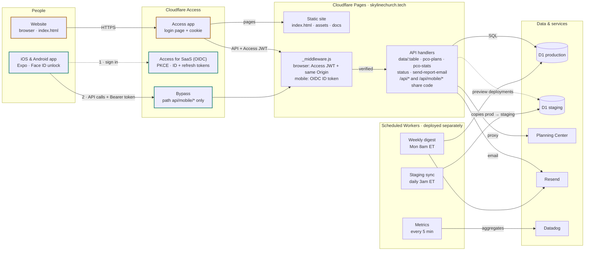

# Architecture

Skyline Pulse has two clients: the website and the iOS/Android app. Both use the same backend on Cloudflare: Pages Functions, the D1 database, and a few scheduled Workers. The only difference between them is how a person signs in and how each request proves who it is.

## System diagram

The website is checked by Access at the edge before Pages sees the request. The app gets its tokens from a separate OIDC application. Its calls to `/api/mobile/*` skip the Access login page, and `_middleware.js` checks each token against that application's signing keys. Preview deployments use the staging database.

## Two ways in

| | Website | Mobile app |
|---|---|---|
| Sign-in | Access login page | Same login, in the phone's browser (OIDC with PKCE), then Face ID to reopen the app |
| Credential | Access cookie, sent to the API as `Cf-Access-Jwt-Assertion` | ID token in `Authorization: Bearer`, renewed with a refresh token |
| Checked by | Access at the edge, then `authorize()` | `authorizeMobile()` only |
| Write protection | Same-origin check | Not needed, because browsers never attach the token |
| Routes | `/api/*` | `/api/mobile/*` |
| Production | Live | Off until the production OIDC application exists |

## Where it lives

| Piece | Repo path | More detail |
|---|---|---|
| Website | `index.html`, `assets/` | [README](../README.md) |
| Sign-in checks | `lib/access.js`, `functions/api/_middleware.js` | [Mobile API](MOBILE-API.md) |
| API handlers | `functions/api/` | |
| Mobile routes | `functions/api/mobile/` | [Mobile API](MOBILE-API.md) |
| Database schema | `migrations/`, `lib/d1-store.js` | [D1 migration](D1-MIGRATION.md) |
| Mobile app | `mobile/` | [Mobile app README](../mobile/README.md), [roadmap](MOBILE-ROADMAP.md) |
| Weekly digest | `cron-worker/` | [README](../README.md#scheduled-jobs) |
| Metrics | `monitoring/` | [Monitoring](MONITORING.md) |
| Staging sync | `staging-sync/` | [Staging sync](STAGING-SYNC.md) |

Push notifications, a calendar, analytics and exports are planned for the app. See the [mobile roadmap](MOBILE-ROADMAP.md).
